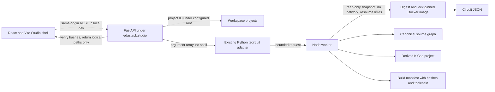

# EDA Studio architecture

**Status:** S0 decisions and first API spike. Existing project schemas and the current sandbox worker remain authoritative where referenced.

## Chosen layout

Studio's Python API lives under `src/edastack/studio` in the existing `edastack` package. It reuses `edastack.adapters.tscircuit.build_tscircuit_project` and does not implement a second compiler path. FastAPI serves versioned REST contracts; Uvicorn binds to loopback. The `apps/studio-web` React/Vite app now provides the routed, responsive three-pane shell and reads health/toolchain state from the local API. Workspace/project management, durable SQLite metadata and a generated TypeScript client remain planned work.

The current HTTP surface is deliberately small:

| Route | Purpose | State |
|---|---|---|
| `GET /api/v1/health` | Service and API version | Implemented; shown in the web shell |
| `GET /api/v1/toolchain` | Installed tool versions and pinned worker/sandbox availability | Implemented; missing tools and unreachable API remain distinct in the web shell |
| `GET /api/v1/session` | Per-process bearer token for local write/execute actions | Implemented |
| `POST /api/v1/projects/{project_id}/compile` | S0 synchronous compile spike for a project folder inside the configured workspace | Implemented and verified end to end; replace with durable jobs in S1 |
| `GET /api/v1/openapi.json` | Runtime OpenAPI document | Implemented |

The web shell's development server runs on `127.0.0.1:5173` and proxies `/api` to the loopback API on port `8765`. It uses system fonts and has no required external network calls. It renders no sample circuit or passing result when a project is not loaded; compile, verify and export actions stay disabled.

The compile request accepts a project ID, not a host path. It invokes the existing bounded worker, validates the returned manifest and every indexed artifact hash, and returns logical relative artifact paths without host paths. A compile result is not a verification result.

## Control and data flow

The worker validates source schemas, hashes the source snapshot, constrains project dependencies, executes without network, validates Circuit JSON and emits immutable output directories. The API is an orchestration layer and does not duplicate compiler or verification logic.

## Canonical source and revision model

Initially accepted source files remain the existing `eda.project.json`, TSX entrypoint/modules, `requirements.json`, `parts.lock.json`, `pcb.constraints.json`, and reviewed local models. Studio UI preferences and workspace indexes live separately. Import does not rewrite the compiler contract.

A frozen revision will identify the complete relevant source/configuration tree, parent revision, toolchain profile and UTC creation time. Builds, checks, approvals and exports attach to that revision plus immutable hashes. Draft edits never change a frozen revision. Revision storage is planned for S1.

## Persistence and artifacts

The S1 metadata owner is one local SQLite database in WAL mode with transactional migrations and explicit single-writer behavior. Immutable artifacts are stored by SHA-256 under a content-addressed root, with a transactional index. Data is first written to a private temporary path, hashed and verified, then atomically promoted; reports never supply arbitrary host paths.

## Status and event contracts

Check dispositions remain separate: `passed`, `failed`, `error`, `not_run`, `measured_only`, `unsupported`, `stale`, `review_required`, `approved`. Job state is separate from check disposition: `queued`, `preparing`, `running`, `collecting`, `completed_pass`, `completed_findings`, `failed_infrastructure`, `cancelled`, `timed_out`, `interrupted`.

Job events use append-only, per-job monotonic sequence numbers and UTC timestamps. Initial event names are `job.queued`, `job.stage_started`, `job.progress`, `job.log`, `job.artifact_indexed`, `job.completed`, `job.failed`, `job.cancel_requested` and `job.cancelled`. Event replay and durable queue behavior are S1 work.

## Toolchain baseline

The repo's supported baseline is Python 3.10+, Node 24.15.0 and npm 11.12.1 for the pinned tscircuit CI path, tscircuit 0.0.3114, React 19.3.1 in the sandbox, and circuit-json-to-kicad 0.0.270 in the worker. The web shell pins React 19.3.0, React Router 7.18.5, Vite 8.3.6 and TypeScript 5.9.3 in its own lockfile. The compiler image is checked against the compiler lock SHA-256. The repo documents ngspice 42+ in Linux CI and ngspice 47 x64 on Windows, and KiCad 10.0.8 for the native validation path. The `/toolchain` route reports the actual local availability; a documented version is not proof that it is installed on the current machine.

## API and shared schema policy

The API prefix is `/api/v1`; every persistent/public payload includes `schema_version: 1`. FastAPI generates the OpenAPI 3 document at `/api/v1/openapi.json`. Shared request/response schemas and literal contract fixtures are versioned under `schemas/studio/v1`. TypeScript types will be generated from this OpenAPI contract in S1. Breaking changes require a new API/schema version and an explicit migration path.
