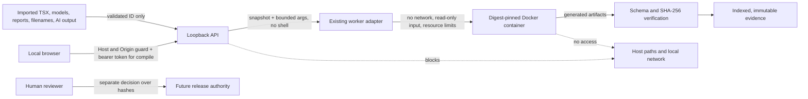

# EDA Studio security model

**Status:** Initial local boundary. This API is not approved for remote access.

## Trust boundary

## Implemented controls

- Uvicorn listens on `127.0.0.1` only; the CLI does not accept a remote bind address.
- The API accepts loopback `Host` values and same-host HTTP `Origin` values by default. `EDA_STUDIO_ALLOWED_ORIGINS` can add loopback development origins only. No permissive CORS middleware is configured.
- A random per-process session token is required by the compile route and is returned with `Cache-Control: no-store` by the local session endpoint.
- The compile route accepts a constrained project ID under `EDA_STUDIO_WORKSPACE_ROOT`, rejects symlink project roots and does not accept a source or output host path from the request.
- The existing Python adapter invokes Node with an argument array and `shell=False`. The worker snapshots inputs, rejects links and path escapes, denies network access, and bounds CPU, memory, process count, output, logs and execution time.
- The API validates the worker manifest, verifies the complete artifact index and hashes, rejects symlinks/unindexed files, and returns only relative names and hashes.
- API errors have stable codes and a request ID; worker exception text and host paths are not sent to the browser.

## Required before broader exposure

- Configure an explicit local workspace root and protect it with filesystem permissions.
- Keep all project import, archive extraction, draft save, revision, cancellation and release operations behind server-side schema/path checks and session authorization.
- Use SQLite transactions, append-only event records and atomic content-addressed artifact promotion before enabling durable jobs.
- Never load artifact files by paths in imported reports; resolve only indexed hashes.
- Treat SVG, logs, netlists, markdown and metadata as untrusted text. Escape rendered content and set a restrictive Content Security Policy when the web shell is served.
- Keep models and compiler execution inside the existing bounded worker. A toolchain availability display is informational; the worker repeats the authoritative sandbox image/lock check before each build.
- Do not bind beyond loopback until an authentication and CSRF design is implemented and reviewed. VPN membership alone is not authorization.
- Bind approvals to source, requirements, parts, constraints, model, toolchain and evidence hashes. An agent may propose but never approve or release.

The current dashboard's path-based report ingestion remains outside the Studio trust boundary. It must be converted to workspace-scoped, indexed artifact access before integration.
